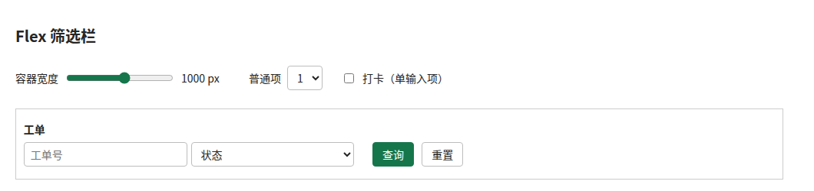
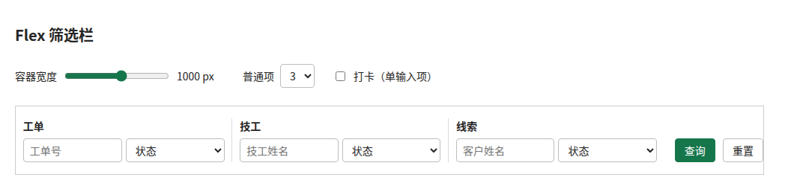

### 使用flex实现按钮跟随、空间不足时内部滚动的筛选栏

筛选栏里，左边是数量不固定的筛选项，右边是查询、重置按钮。希望得到这样的效果：

- 空间充足时，按钮紧跟筛选项，不固定在容器最右边。
- 空间不足时，筛选区缩小，为按钮保留位置。
- 筛选项缩到最小宽度后，不再继续缩小，而是在筛选区内部横向滚动。
- 宽度配置相同的筛选项保持等宽。

可以用两层flex布局配合`overflow: auto`实现，不需要用JS计算布局宽度。

#### 效果

只有一个普通项、容器宽度为1000px时，筛选项保持450px宽，按钮紧跟在后面，右侧保留空白：



三个普通项、容器宽度为1000px时，各项从450px等宽收缩，按钮仍留在容器内：



容器缩到600px时，各普通项保持260px的最小宽度，筛选区内部横向滚动，按钮不被挤出去：


#### HTML结构

筛选项包在一个容器里，按钮作为这个容器的兄弟元素，而不是放进滚动区域：

```html
<div class="search-section">
  <div class="search-items">
    <div class="search-item">
      <div class="search-item-label">工单</div>
      <div class="search-item-inputs">
        <div class="search-item-input">
          <input placeholder="工单号">
        </div>
        <div class="search-item-input">
          <select>
            <option>状态</option>
            <option>待处理</option>
          </select>
        </div>
      </div>
    </div>

    <div class="search-item">
      <div class="search-item-label">技工</div>
      <div class="search-item-inputs">
        <div class="search-item-input">
          <input placeholder="技工姓名">
        </div>
        <div class="search-item-input">
          <select>
            <option>状态</option>
            <option>空闲</option>
          </select>
        </div>
      </div>
    </div>
  </div>

  <div class="search-btns">
    <button type="button">查询</button>
    <button type="button">重置</button>
  </div>
</div>
```

#### CSS

```css
* {
  box-sizing: border-box;
}

.search-section {
  display: flex;
  gap: 1em;
  align-items: flex-end;
  white-space: nowrap;
}

.search-items {
  display: flex;
  overflow: auto;
}

.search-item {
  padding: 0 .7em;
  min-width: 260px;
  max-width: 450px;
  width: 450px;
  flex-grow: 1;
}

.search-item:not(:first-child) {
  border-left: 1px solid #ddd;
}

.search-item-label {
  margin-bottom: 6px;
}

.search-item-inputs {
  display: flex;
  gap: 5px;
}

.search-item-input {
  width: 0;
  flex-grow: 1;
}

.search-item-input > * {
  width: 100%;
}

.search-btns button:not(:last-child) {
  margin-right: .5em;
}
```

#### 为什么能这样布局

**外层决定按钮跟随和空间分配。**

`.search-section`使用flex布局，默认`flex-wrap: nowrap`，所以筛选区和按钮区始终在同一行。`white-space: nowrap`则让按钮之间的文字空白不产生换行。

`.search-items`没有设置`flex-grow: 1`，不会主动占满外层剩余空间。因此筛选项较少时，按钮跟在筛选区后面，而不是被推到最右边。这里也不要给外层设置`justify-content: space-between`，否则有空余空间时按钮会被推向右侧。

**筛选区允许收缩，内容在内部滚动。**

作为外层flex子项，`.search-items`默认具有`flex-shrink: 1`。同时，`overflow: auto`使它在主轴上的自动最小尺寸为0，可以缩到小于内部筛选项的总最小宽度。

按钮区没有设置滚动，且内容不换行，它的自动最小宽度会约束收缩。因此空间不足时，主要由左侧筛选区让出空间，按钮仍然可见。

**内层先缩小筛选项，再产生滚动。**

每个普通`.search-item`以450px为初始宽度，默认允许收缩，但不能小于260px。同类项的初始宽度、收缩系数和最小宽度都相同，所以收缩时保持等宽。缩到260px后，如果仍然放不下，就由`.search-items`产生横向滚动。

这里的等宽不是单靠`flex-grow: 1`实现的。初始宽度或最小宽度不同的项，不会自动变成相同宽度。

每个筛选项内部的`.search-item-input`使用`width: 0; flex-grow: 1`，让两个控件等分该项内的可用宽度；控件本身设置`width: 100%`填满各自的容器。

#### 只有一个输入框的筛选项

单输入项可以使用更小的宽度范围，避免占用和双输入项一样多的空间：

```css
.search-item:has(.search-item-input:only-child) {
  min-width: 145px;
  max-width: 235px;
  width: 235px;
}
```

`:has(.search-item-input:only-child)`匹配内部存在“同级中唯一的输入容器”的筛选项。它的宽度规则与普通项不同，所以不会与普通项等宽：


#### 注意

- 不要给`.search-items`设置`flex-shrink: 0`，否则它不能收缩，可能把按钮挤出容器。
- 不要把按钮放进`.search-items`，否则按钮也会跟着筛选项一起滚动。
- 隐藏滚动条不会改变布局，但需要保留触摸、触控板或键盘等滚动方式。
- 这不是任意窄屏都不溢出的保证。如果容器窄到连按钮区和间距都放不下，就需要额外设计换行、竖排或精简按钮的响应式规则。
